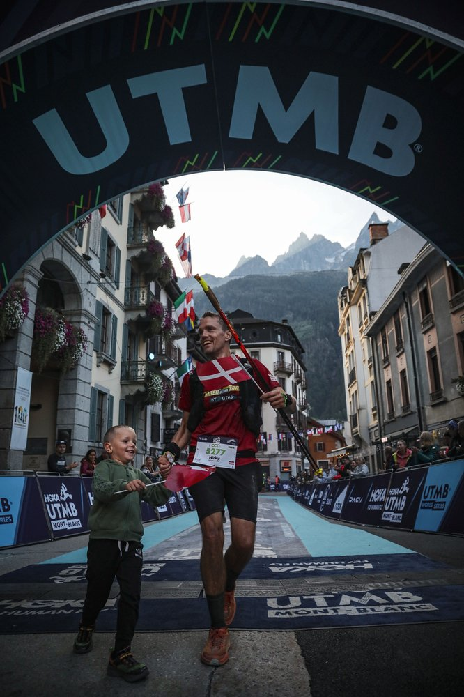

<!-- Hero / intro -->
<section class="home-hero">
  
  

    <h1>Running++</h1>
    
I'm Nicky Bass Mølholm. I share my running experiences, race reports and training notes here.

    

      <a class="badge result-badge result-badge--strava mr-1" href="https://www.strava.com/athletes/89837533" target="_new" rel="noopener">
        <i class="fa-brands fa-strava"></i> Strava
      </a>
      <a class="badge result-badge result-badge--utmb mr-1" href="https://utmb.world/en/runner/4879951.nicky.bassmolholm" target="_new" rel="noopener">
        <i class="fa-solid fa-mountain"></i> UTMB
      </a>
      <a class="badge result-badge result-badge--itra mr-1" href="https://itra.run/api/RunnerSpace/GetRunnerSpace?memberString=mWeU4v%2B0oGPGf9LMOe6wgw%3D%3D" target="_new" rel="noopener">
        <i class="fa-solid fa-shield"></i> ITRA
      </a>
      <a class="badge result-badge result-badge--duv mr-1" href="https://statistik.d-u-v.org/getresultperson.php?runner=2012387" target="_new" rel="noopener">
        <i class="fa-solid fa-chart-line"></i> DUV
      </a>
    

  

  
  
</section>

<!-- Main: latest posts + sidebar -->
<section class="home-grid">
  

  

  Get upcoming races by joining current + next year calendars and filtering future races
  {% assign current_year = site.time | date: "%Y" %}
  
  {% assign today = site.time | date: "%Y-%m-%d" %}
  
  
  
  
  
  
  
  
  
  {% assign upcoming_race_year = upcoming_races | map: "date" | first | date: "%Y" | default: current_year %}
  
  

  
  

  
  
  

  

    
    

  
  

  

      

  <h5 class="mb-2 d-flex align-items-center gap-1">About 👤</h5>
  
I run a lot these days. In fact it may be borderline crazy to most folks; I am primarily a trail and ultra runner. Trail runs are just everything besides normal road running. Ultra running is...

  
<a class="btn btn-sm stretched-link" href="/about">More</a>

      

    

  

</section>
